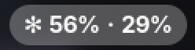
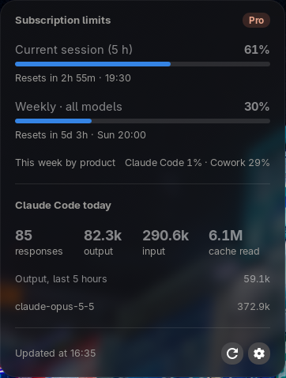
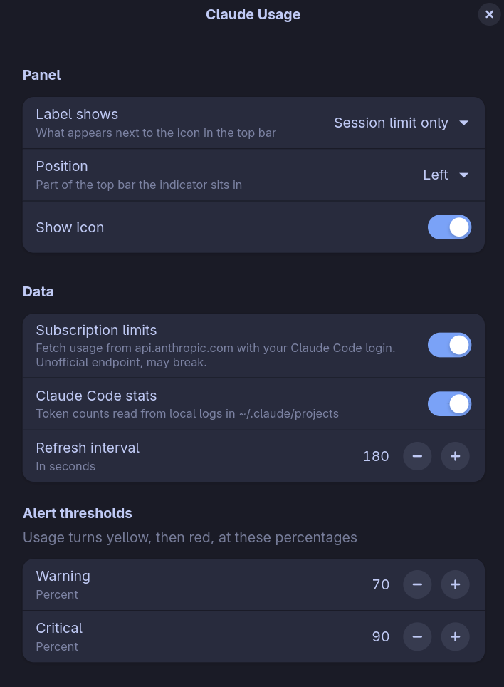

# Claude Usage — GNOME Shell extension

A small top-bar indicator for GNOME Shell that shows how much of your **Claude subscription limits** you have used, plus your **Claude Code token usage** for the day, read from local logs.



By default the label `✻ 56% · 29%` reads as **current 5-hour session limit · weekly limit**. It turns yellow at 70% and red at 90%.

Click it to open the details:



## Features

- **Subscription limits**: a progress bar, percentage and reset time for the 5-hour session window, the weekly window, and the per-model weekly windows (Opus / Sonnet) when your plan has them. It also shows the weekly breakdown by product (Claude Code, Cowork, …).
- **Local Claude Code stats** (works offline): today's responses, output/input tokens and cache reads, output over the last 5 hours, and tokens per model.
- **Color alerts**: the label and bars turn yellow, then red, at thresholds you choose.
- **Settings window** to pick what the label shows, where it sits, and what is fetched.
- Refreshes on a timer (3 minutes by default) and on demand from the refresh button.
- When the limits can't be fetched, the label shows today's output tokens instead.

## How it works

| Part | Role |
|---|---|
| `claude-usage@perso/claude-usage.py` | Collects data and prints JSON. You can run it on its own: `python3 claude-usage@perso/claude-usage.py --limits` |
| `claude-usage@perso/extension.js` | The panel indicator. It runs the script asynchronously on each refresh. |
| `claude-usage@perso/prefs.js` | The settings window. Settings are stored with GSettings (`schemas/`). |

Data sources:

- **Local logs**: `~/.claude/projects/**/*.jsonl`, written by Claude Code. These are never sent anywhere.
- **Subscription limits**: the **undocumented** endpoint `https://api.anthropic.com/api/oauth/usage` (the one behind Claude Code's `/usage`). The extension authenticates with the OAuth token stored in `~/.claude/.credentials.json`, and that token is sent only to `api.anthropic.com`. The endpoint may change or break without notice. To stay fully offline, turn off **Subscription limits** in the settings.

## Requirements

- GNOME Shell 48, 49 or 50
- `python3` (standard library only)
- [Claude Code](https://claude.com/claude-code) logged in with a Claude subscription (needed for the limits; the local stats only need the logs)

## Installation

```sh
git clone https://github.com/BlasterWhite/claude-usage-gnome.git
cd claude-usage-gnome
./install.sh          # compiles the settings schema and symlinks the extension
                      # into ~/.local/share/gnome-shell/extensions
```

On Wayland, log out and back in, then run:

```sh
gnome-extensions enable claude-usage@perso
```

To test in a nested shell without leaving your session (GNOME ≥ 49):

```sh
dbus-run-session gnome-shell --devkit --wayland
```

Logs: `journalctl -f -o cat /usr/bin/gnome-shell`

## Settings

Open them from the gear button in the menu, or with `gnome-extensions prefs claude-usage@perso`.



| Setting | Default | |
|---|---|---|
| Label shows | Session and weekly limits | Or session only, weekly only, or Claude Code output tokens today |
| Position | Left | Left, center or right part of the top bar |
| Show icon | On | The `✻` before the label |
| Subscription limits | On | Off = local logs only, no network |
| Claude Code stats | On | Show the local stats section |
| Refresh interval | 180 s | 30 s to 1 h |
| Warning / Critical | 70 % / 90 % | Thresholds for yellow and red |

## Known limitations

- If the OAuth token has expired, the menu says so. Run Claude Code once so it refreshes the token.
- The limits endpoint is unofficial and may stop working at any time.

## License

[MIT](LICENSE)
